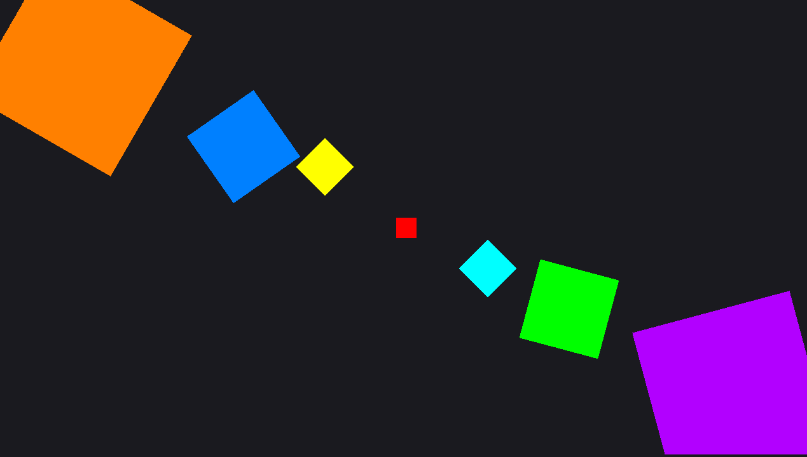
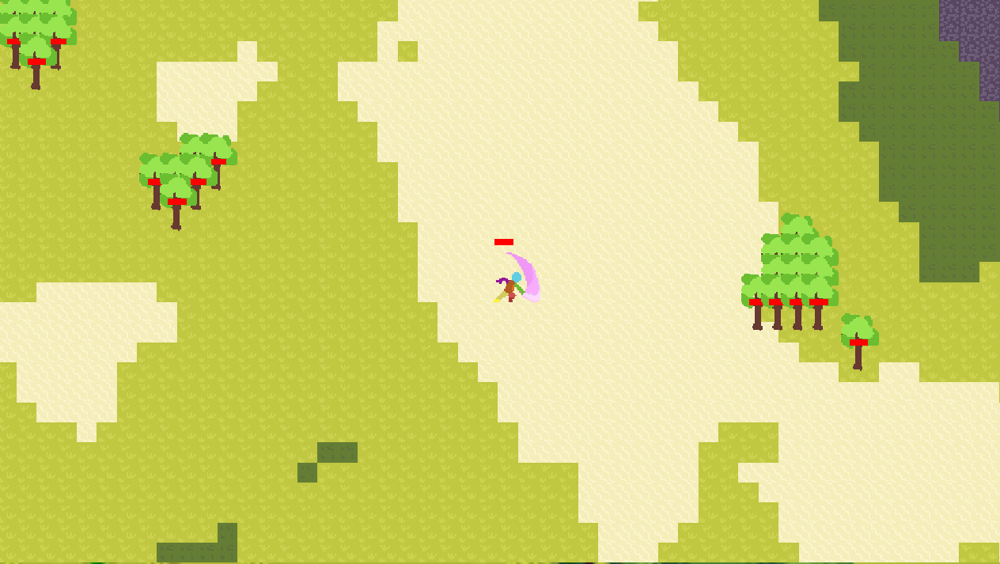
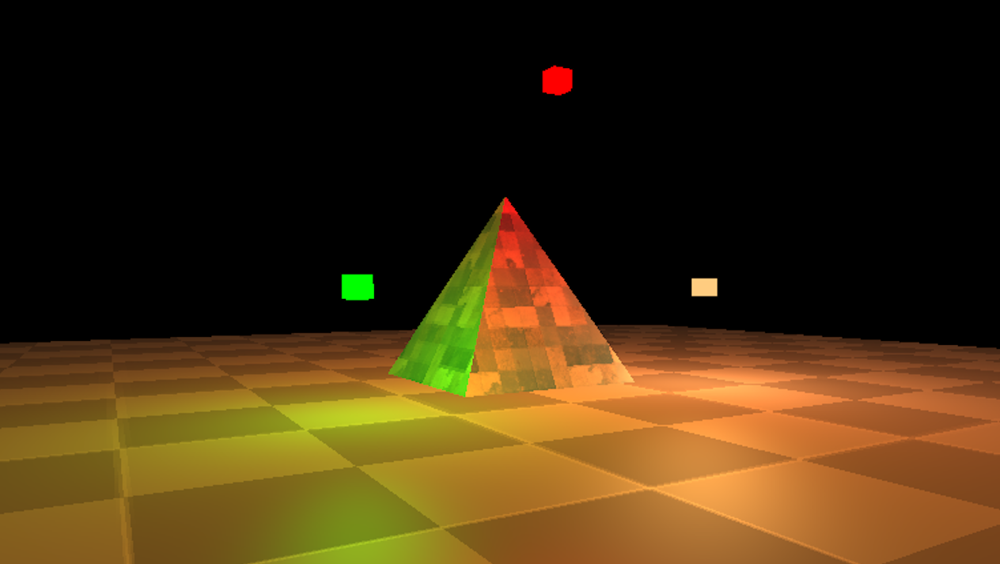
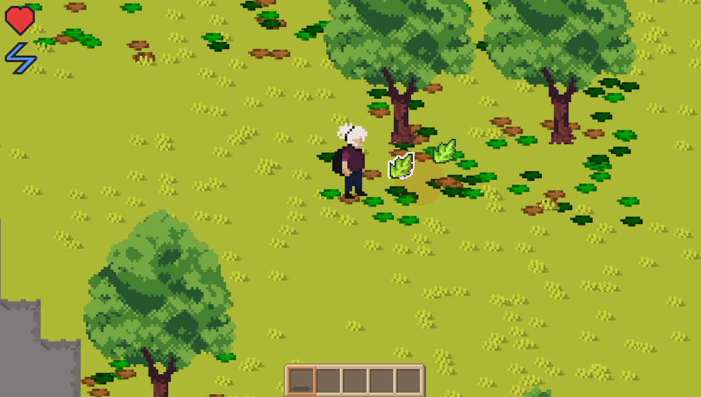
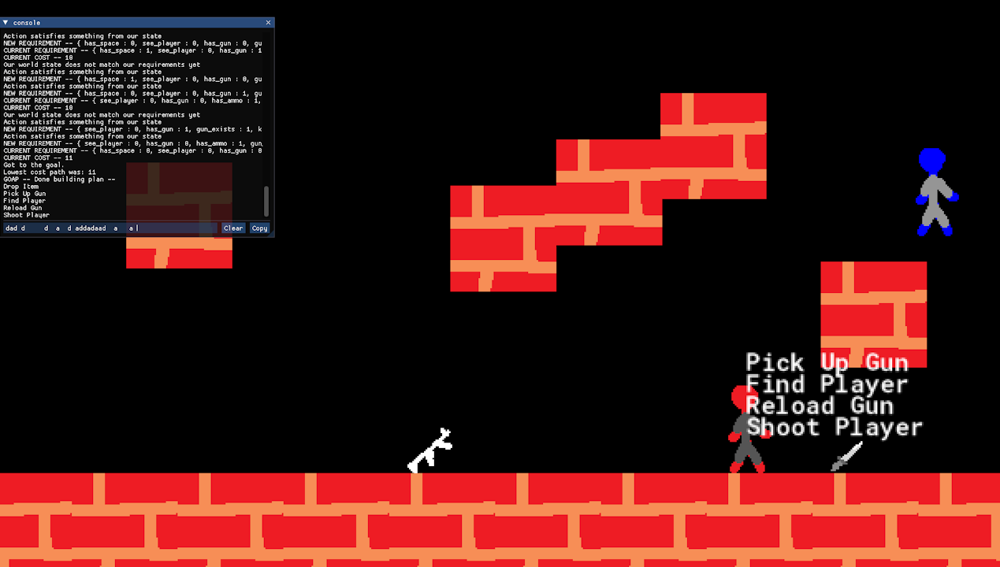
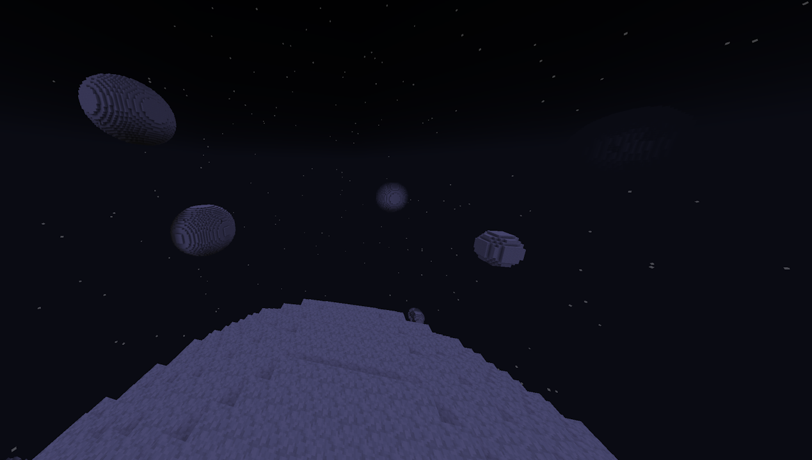

## Hi, I'm Adam.

**I'm a Mathematics-Computer Science student at the University of California, San Diego, and an aspiring graphics programmer.**

My journey started out in video game development and in the past few years, I've discovered a strong interest in the underlying mathematics and low-level programming behind computer graphics.

#### [My GitHub](https://github.com/adam-mathe/) • [My Resume](https://github.com/adam-mathe/)

## My Favorite Projects

|  |  |
| :---: | :---: 
| [Rain Framework](/portfolio/rainstorm) | [Cadaver Rewrite](/portfolio/cadaver-rewrite) |
|  | 
| [3D Rendering Prototypes](/portfolio/3d) | [Cadaver](/portfolio/cadaver) |
|  |  |
| [Game AI Prototypes](/portfolio/ai) | [Space Survival](/portfolio/space) |
