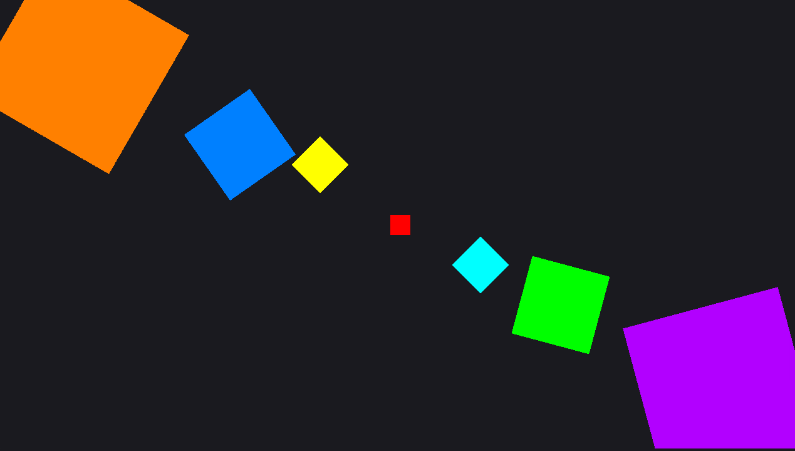
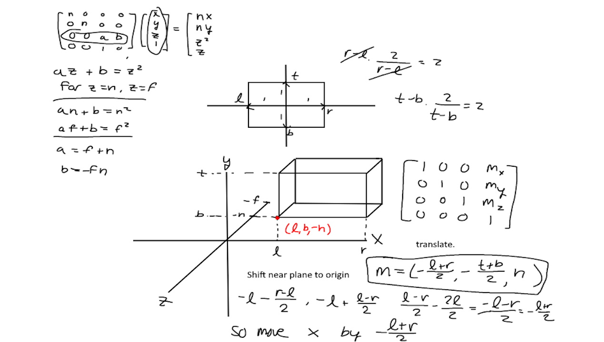

<script>
  document.title = "Adam Mathe";
</script>

## Rain Framework

### Rain is a 2D framework I am currently developing without the use of an external math library.

2026 - Present

**Tech:** `C++` `OpenGL` `GLFW`

|  |  |
| :---: | :---|
| *A scene rendered using Rainstorm and its linear algebra library.*| *Some notes I made to understand and derive the orthographic projection matrix.* |

## Motivation Behind the Project

Coming into this project I had a decent amount of experience with C++ and OpenGL, but I relied on GLM for matrix math.

With Rain 2D, my goal is to learn the linear algebra behind graphics programming by deriving and implementing each function by hand.

## Key Features

In the project so far, I have developed a matrix library which includes:
* Matrix multiplication
* Scale matrices
* Translation matrices
* Rotation matrices
* Orthographic projection matrices

<details markdown="1">

<summary><strong>View Example Rendering Loop Code</strong></summary>

> *Example code for the framework, renders an aqua 32 x 32 pixel square in the middle of a 1280 x 720 px screen.*

```c++
int main()
{
    return 0;
}
```

</details>

## Future Plans

As this project continues, I plan to derive the arbitrary axis rotation matrix and implement the perspective projection matrix.

## Source Code & Repository

[View Source Code](https://github.com/adam-mathe/rain-framework.git)
